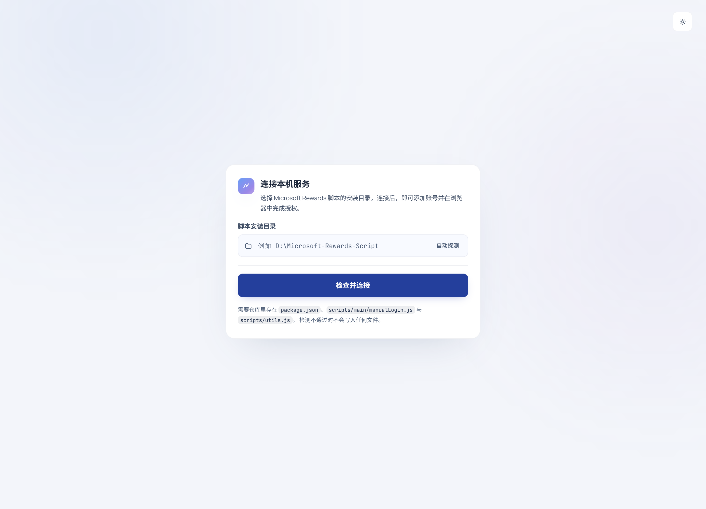
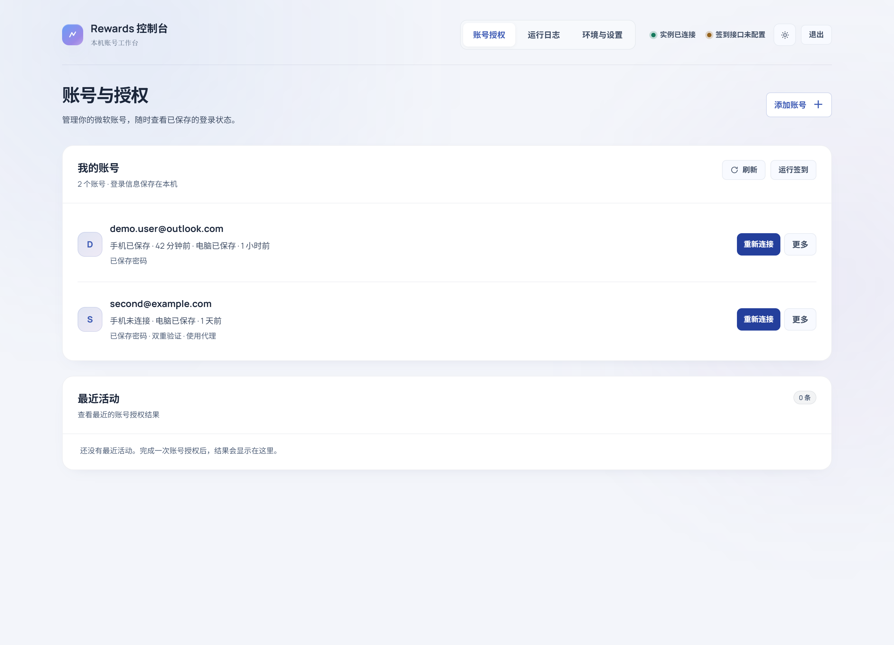
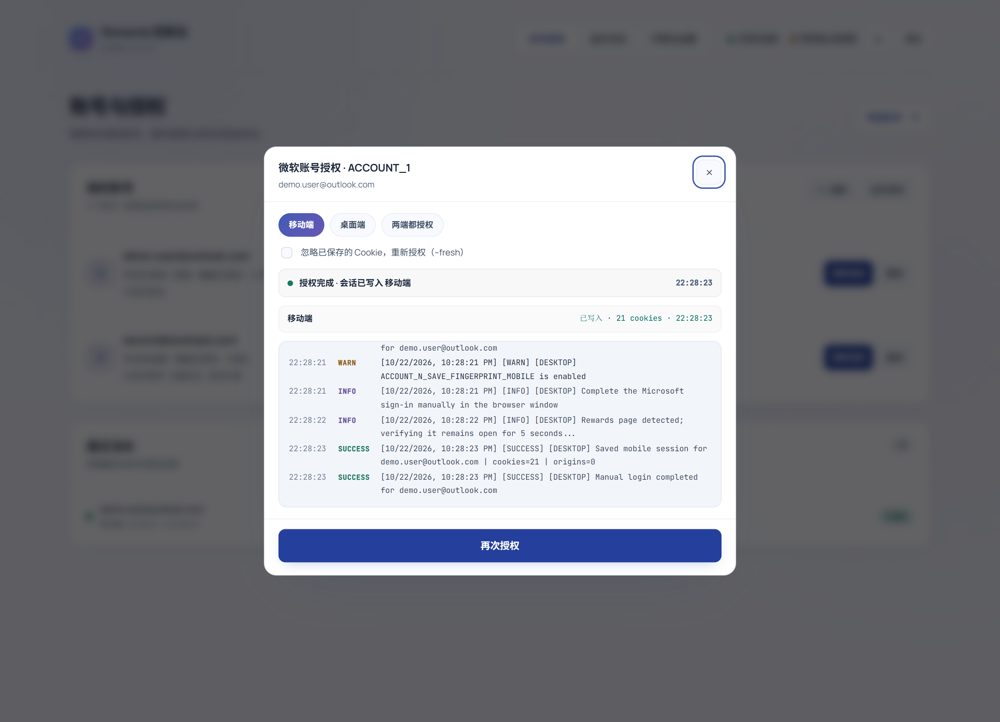
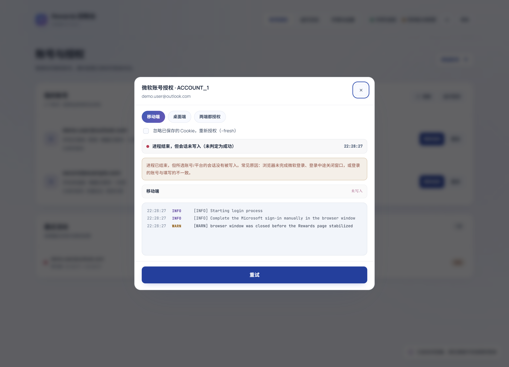
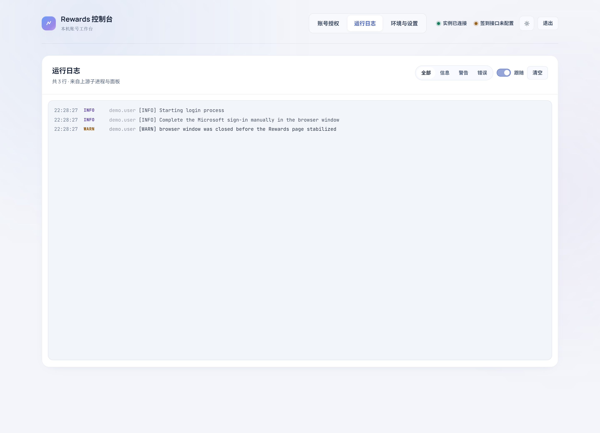
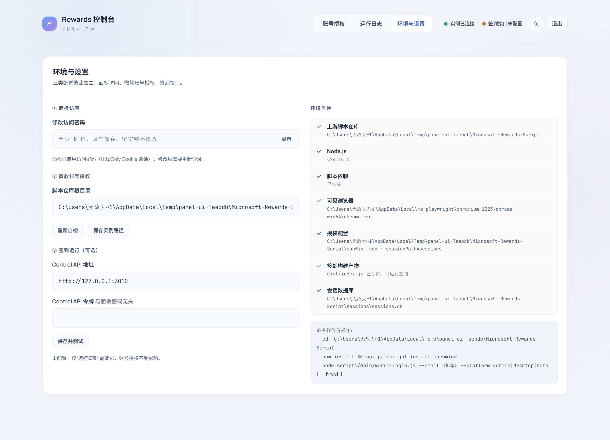
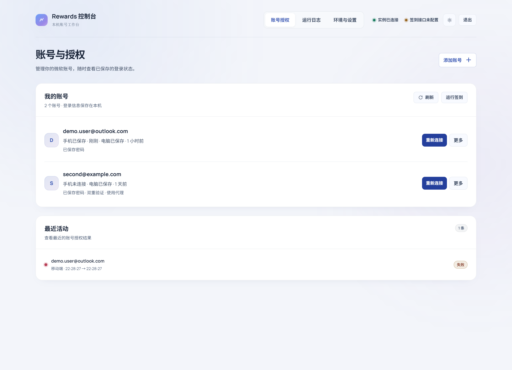
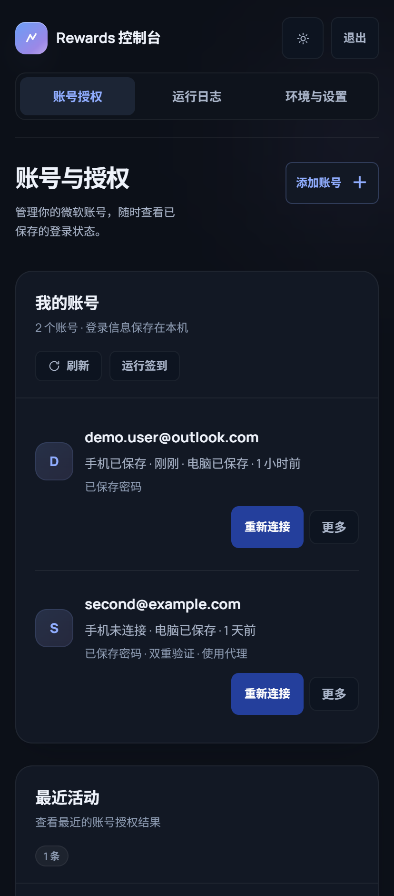

# Rewards 控制台

给 [TheNetsky/Microsoft-Rewards-Script](https://github.com/TheNetsky/Microsoft-Rewards-Script) 用的**本地签到与授权控制台**：在网页上添加账号 → 登录微软账号 → 一键运行签到，支持停止运行、任务记录和可视化设置。登录会话自动写回 `sessions.db`，之后签到时复用。

界面使用黑白灰中性配色：首页突出确认积分、运行状态与待处理账号，桌面顶部导航、手机底部导航。零构建、零依赖，只用 Node.js 内置模块。

**无桌面服务器 / Docker：** 已提供完整 Chromium 和按需远程授权方案，详见 [Docker 部署说明](docs/Docker部署.md)。在此目录执行 `docker compose up -d --build`，授权时从面板打开远程浏览器；默认内存上限 1.5 GiB。

**国区升级（2.1）：** Docker 默认使用国内热词和中文本地兜底，支持纯中文离线词源、搜索/阅读间隔设置、真实等待倒计时、14 天积分趋势、每账号余额和 PushPlus / Server酱结果通知。保留固定版本上游内核与现有会话结构，无新增服务或前端框架。详见 [国区升级说明](docs/国区升级-2026-10-26.md)。

**签到工作台：** 首页直接一键运行全部账号或停止，账号列表可单独运行，实时查看当前账号、任务、耗时和确认积分。「设置 → 签到设置」提供任务开关、搜索/账号间隔、搜索词来源和每日定时，保存后无需重启。详见 [工作台与设置说明](docs/签到工作台与设置-2026-10-26.md)。

**签到记录：** Docker 模式下，点击「查看任务记录」或进入「任务记录」，可按日期查看每轮签到的任务、结果、积分及原始输出，保存最近 30 天。详见 [签到任务记录](docs/签到任务记录-2026-10-26.md)。


**界面调整（2026-10-26）：** 精简统计卡片与重复说明，账号积分先于历史趋势展示；保留原有数据口径、任务设置和授权流程。可用 `npm run preview:ui` 打开完全隔离的虚构数据预览，详见 [UI 调整说明](docs/UI调整-2026-10-26.md)。

---

## 它解决什么

原脚本的手动登录是这样的：

```bash
cd Microsoft-Rewards-Script
# 先手改 .env 填 ACCOUNT_1_EMAIL / ACCOUNT_1_PASSWORD / ...
npm run manual-login -- your@email.com --platform mobile
```

每次加账号、改密码、重登都要重复上面这套。本面板把它搬到浏览器里：

| 原来的操作 | 现在 |
| --- | --- |
| 手工编辑 `.env`，容易写错键名、漏字段 | 表单填写，实时校验，写入前自动备份 |
| 记 `--platform mobile/desktop/both`、`--fresh` | 单选胶囊，一眼看清 |
| 终端里盯日志猜进度 | 子进程输出经 SSE 实时推送到页面，按级别着色 |
| 不知道会话到底存没存 | **以 `sessions.db` 是否真的写入为准**，逐平台显示 cookie 数与时间 |
| 环境缺依赖要跑到报错才知道 | 首次进入先做环境自检（仓库/Node/依赖/Chromium/构建） |

---

## 快速开始

### 1. 放进脚本仓库（推荐）

```text
Microsoft-Rewards-Script/
├── src/
├── scripts/
├── config.json
├── .env
└── rewards-login-ui/          ← 放这里
    ├── server.js
    └── public/
```

```bash
cd Microsoft-Rewards-Script/rewards-login-ui
node server.js
```

终端会打印访问密码：

```text
  地址        http://127.0.0.1:4173
  实例目录    D:\Microsoft-Rewards-Script
  访问密码    xxxxxxxxxxxxxxxx
              （来源：generated，已写入 config.json）
```

打开 <http://127.0.0.1:4173>，输入密码进入面板。

### 2. 放在任意位置

```bash
node D:\tools\rewards-login-ui\server.js
```

进入面板后会自动探测上级目录；探测不到就手动填写脚本仓库根目录，面板会先做环境自检，通过后才允许连接。

### 3. 环境变量

| 变量 | 默认 | 说明 |
| --- | --- | --- |
| `PANEL_PORT` | `4173` | 监听端口 |
| `PANEL_HOST` | `127.0.0.1` | 监听地址 |
| `PANEL_TOKEN` | 自动生成 | 面板访问密码（优先于 `config.json`） |
| `PANEL_NO_AUTH` | 关 | 设为 `1` 关闭面板鉴权（界面会明确警告） |
| `PANEL_CONFIG` | `./config.json` | 面板自身配置路径 |
| `BOT_DIR` | 无 | 预置脚本仓库路径 |

> ⚠️ 面板会读写 `.env` 并启动浏览器进程，**只在本机使用**。不要暴露到局域网或公网；真要暴露必须先设 `PANEL_TOKEN` 并加反向代理 TLS。

---

## 界面

以下截图来自早期版本；当前首页增加签到工作台，账号编辑使用弹窗，新增签到设置以实际页面和上方说明为准。

### 首次设置：环境自检



逐项检查上游仓库、Node 版本、依赖、Chromium 内核、构建产物、config.json 与会话库。**阻断项不通过就不会连接，也不会写任何文件。**

### 账号授权



- 列出 `.env` 里全部 `ACCOUNT_N_*`，显示手机/电脑会话是否已保存及更新时间。
- 每行直接提供**运行此账号**、**登录账号**；**编辑**、**删除**收在「更多」菜单。
- 弹窗表单新增/编辑账号：邮箱、密码、TOTP、国家/地区、语言；代理、备用邮箱、指纹开关收在「高级选项」。
- 编辑时密码、TOTP、备用邮箱、代理、**指纹开关**留空/未改动即保持原值。

### 授权结果以会话文件为准

| 成功 | 失败（脚本打印了成功日志、退出码 0，但没写会话） |
| --- | --- |
|  |  |

四种终态：`done`（全部平台写入）/ `partial`（两端只写了一端）/ `failed`（非零退出码，或正常退出但没写会话）/ `cancelled`（用户终止）。

判定依据是该账号该平台的 `updated_at` **严格大于任务开始前的基线**，所以任务前就存在的旧会话不会被误判为「本次成功」。

### 运行日志



### 环境与设置



三类配置彼此独立：**① 面板访问**（改密码）、**② 微软账号授权**（仓库路径 + 自检）、**③ 签到运行**（Control API，可选）。

浅色与窄屏：

| 浅色 | 移动端 |
| --- | --- |
|  |  |

---

## 安全模型

| 项 | 做法 |
| --- | --- |
| 面板访问 | 独立访问密码 + HttpOnly/SameSite=Strict Cookie（HMAC-SHA256，12h）；退出登录会使所有旧 Cookie 立即失效；连续 5 次错误锁 30 秒 |
| 接口保护 | 除 `/api/auth/*` 与 `/api/health` 外所有 `/api/*`（含 SSE）都要求有效会话，否则 401 |
| 与上游令牌的关系 | Control API 令牌是独立字段，只用于请求上游 API，**不能**用来访问面板 |
| 凭据写入 | 所有字段拒绝换行/控制字符；引号处理与上游 `loadEnvFile` 解析规则一致；写入前备份 `.env.panel.bak`（0600） |
| 目录校验 | 连接与每个写入入口都校验上游仓库结构，非法目录 422 且不创建文件 |
| 会话读取 | `sessions.db` 只读，只读元信息（时间、cookie 数量），从不导出 Cookie 内容 |
| 密码回显 | 只回传掩码（`Te••••23`），编辑时不回填明文 |

---

## 可选的 Control API 接入

「签到」按钮依赖上游自带的 Control API；账号授权**不需要**它。

```bash
# 1) 生成令牌
node -e "console.log(require('crypto').randomBytes(32).toString('hex'))"

# 2) 写入 .env（注意：这是上游 API_TOKEN，不是面板密码）
API_TOKEN=粘贴上一步生成的令牌
API_HOST=127.0.0.1
API_PORT=3010

# 3) 启动
npm run api
```

回到面板「环境与设置 → ③ 签到运行」，填地址与令牌并保存。面板只会调用 `/health`、`/start`、`/stop`。状态分为在线 / 令牌无效 / 接口异常 / 未配置四态，401 不会被显示成「在线」。

---

## 它到底改了哪些文件

| 路径 | 行为 |
| --- | --- |
| `<仓库>/.env` | 只增删改 `ACCOUNT_N_*` 行；注释、其他变量、账号顺序一律保留；写入前备份 `.env.panel.bak` |
| `<仓库>/sessions/sessions.db`（或 `config.sessionPath` 指定处） | **只读** |
| `rewards-login-ui/config.json` | 面板自身的访问密码、实例路径、Control API 设置（0600） |
| 浏览器 `localStorage` | 仅主题偏好；退出时清空 |

面板不创建上游的 `config.json`，也不会上传任何数据。

---

## 测试与自测

```bash
# 27 项自动化回归（临时沙箱、虚构数据，跑完自动清理）
node tools/acceptance.mjs

# Docker、持久化记录和工作台/设置与国区检查（另 28 项）
npm run test:docker
npm run test:activity
npm run test:run
npm run test:china

# 重新生成 docs/shots 下的全部截图
node tools/ui-shots.mjs
```

回归覆盖：鉴权拦截、错误密码、配置覆盖、目录校验、换行注入、特殊字符往返、指纹保留、邮箱校验、重复邮箱、备份、自定义 sessionPath、四种任务终态、Control API 三态、退出作废会话、面板重启后会话仍在、再次授权刷新时间戳。

**真实账号链路需要你自己跑一遍**（自动化无法代劳）：

1. `node server.js` → 输入终端打印的密码；
2. 首次设置页填仓库路径，确认自检全绿（缺依赖按提示 `npm install` / `npx patchright install chromium`）；
3. 添加账号 → 点「登录账号」→ 在本机窗口或 Docker 远程浏览器中完成微软登录；
4. 弹窗出现「移动端 已写入 · N cookies」即成功；显示「未写入」时会给出原因；
5. 关闭面板再启动，账号行仍显示「移动端 · N cookies · x 分钟前」= 会话可复用；
6. 两端都要：选「两端都授权」，只完成一端会显示 `partial` 并指出缺哪个平台；
7. 建议顺手试一次失败路径：授权时直接关掉浏览器窗口，面板应显示失败而不是成功。

---

## 常见问题

**探测不到实例目录？**
把 `rewards-login-ui` 放进仓库根目录，或在首次设置页手填绝对路径。校验要求存在 `package.json`（name 为 microsoft-rewards-script）、`scripts/main/manualLogin.js`、`scripts/utils.js`。

**忘了面板密码？**
看终端启动时打印的那一行，或读 `rewards-login-ui/config.json` 里的 `panelToken`（也可用 `PANEL_TOKEN` 环境变量覆盖）。

**点「授权」后浏览器没出现？**
看环境自检的提示，通常是缺依赖或缺 Chromium 内核：

```bash
cd <仓库>
npm install
npx patchright install chromium
npm run build
```

**为什么移动端和桌面端要分别授权？**
上游用不同的浏览器指纹与会话文件区分两端，奖励任务也分 PC / Mobile 两套，两边都授权才能拿满。

**TOTP 密钥怎么拿？**
微软安全设置 →「管理登录方式」→ 添加验证器应用 → 二维码页面选「手动输入代码」，把那段密钥填进表单。

**面板重启后任务记录还在吗？**
「最近授权任务」只保留在当前面板进程内存里，重启即清空（与上游 Control API 行为一致）；但**会话文件是持久的**，重启后账号行依然显示已授权状态。

---

## 目录结构

```text
rewards-login-ui/
├── server.js              # 零依赖 HTTP 服务：鉴权、仓库校验、.env 读写、sessions.db 只读、子进程与 SSE
├── public/
│   ├── index.html         # 解锁页 + 首次设置 + 控制台 + 弹窗
│   ├── css/styles.css     # 设计令牌、背景氛围、液态按钮、响应式
│   └── js/app.js          # 视图切换、表单、SSE 日志流、主题
├── tools/
│   ├── acceptance.mjs     # 27 项回归测试
│   └── ui-shots.mjs       # 截图生成
├── docs/
│   ├── 修复验证报告-2026-10-22.md
│   └── shots/
├── config.json            # 运行时生成
└── README.md
```

## 许可

与上游脚本保持一致，仅供本机自用。使用自动化脚本可能违反微软服务条款，账号风险自负。
