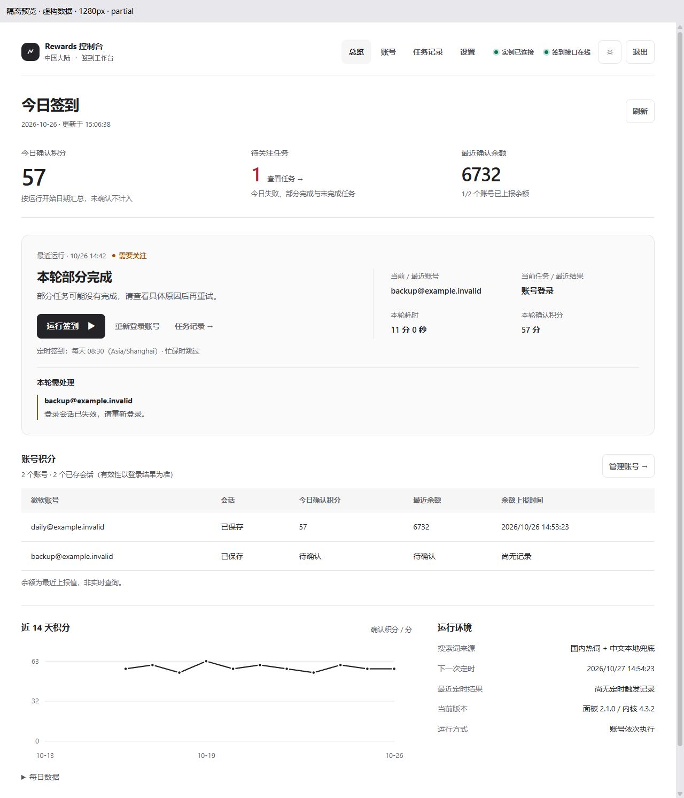
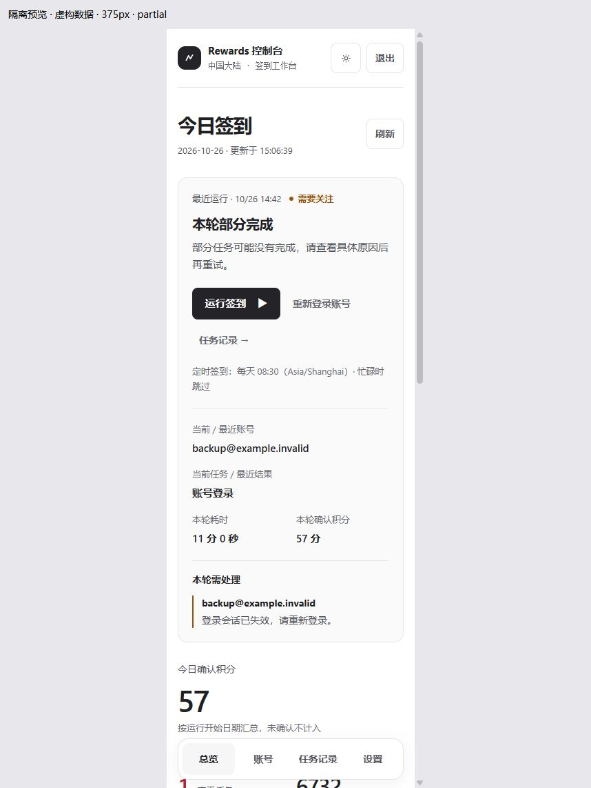

# 签到控制台 UI 调整

## 首页先回答今天的结果和下一步操作

- 桌面首页将五张同权重统计卡缩为三项摘要：今日确认积分、待关注任务、最近确认余额。账号及会话数量放回账号区。
- 运行区保留本轮状态、操作、耗时和确认积分；直接列出本轮出问题的账号与原因，并提供重新登录或任务记录入口。
- 最近运行显示日期和时间，避免把昨天的完成状态看作今天的结果。旧运行的问题不会串到新一轮运行中。
- 手机优先展示运行操作，桌面导航放在顶部，手机导航保留在底部。
- 账号积分置于趋势图之前；删去宣传式文案、装饰色点和反复解释界面的文字。

## 样式按职责组织，不再叠加换肤

`public/css/styles.css` 统一主题与组件，`public/css/dashboard.css` 只负责总览布局。移除 `cdk.css` 覆盖层及旧背景、光效、渐变。实色主按钮统一为 `primary-btn`，同步更新全部使用处，移除无消费者的指针光效监听。

浅色与深色均使用中性底色；颜色只用于状态和异常。积分仍保留零、未知、部分余额覆盖等原有含义，未更改后端、会话结构或签到内核。

## 查看隔离预览

```powershell
npm run preview:ui
```

打开 <http://127.0.0.1:4186/__preview?width=1280>。将 `width` 改为 `375`、`414`、`768`、`1024` 或 `1440` 可检查对应宽度；`scenario` 支持 `partial`、`completed`、`running`、`empty`、`offline`。预览使用虚构账号，启动和停止仅改变内存状态，不读取真实配置、不调用微软接口，也不启动签到进程。





## 验证与使用

已通过 19 项针对性测试，覆盖总览零值与未知值、余额覆盖率、刷新失败与会话失效、趋势断点、异常账号归属、问题内容转义、按钮去重，以及原有签到启停、设置与国区相关行为：

```powershell
node --test tools/dashboard-ui.test.mjs tools/run-console.test.mjs tools/run-api.test.mjs tools/china.test.mjs
```

浏览器实际检查：五档屏宽、浅色与深色、管理账号与新增弹窗、重新登录入口、任务记录入口、隔离启停和倒计时。窄屏表格在自身容器内横向滚动，页面与导航不横向溢出。

本次交付为本地源码更新，未替换正在使用的 Docker 容器。将源码同步到现有部署目录后，使用原来的环境变量与数据目录，在没有签到或授权进行时运行：

```sh
docker compose up -d --build rewards
```

容器健康后刷新页面；如浏览器仍显示旧界面，强制刷新。直接用 Node 运行的实例不需要构建，刷新即可加载新静态文件。

## 用户提供的脚本猫脚本

《微软积分商城签到（改进版）》3.6.52 包含桌面和移动端搜索分支，读取 `mobileSearch` 进度，以移动端请求头执行搜索；签入与阅读通过 OAuth 取得令牌，访问 Rewards 平台活动接口。阅读和活动部分会按执行次数或任务标称分值累加本地结果，因此本地“完成”消息仍应与微软实际进度、余额区分。

此处仅核对附件源码，没有执行该脚本，也没有用它替换当前内核。
