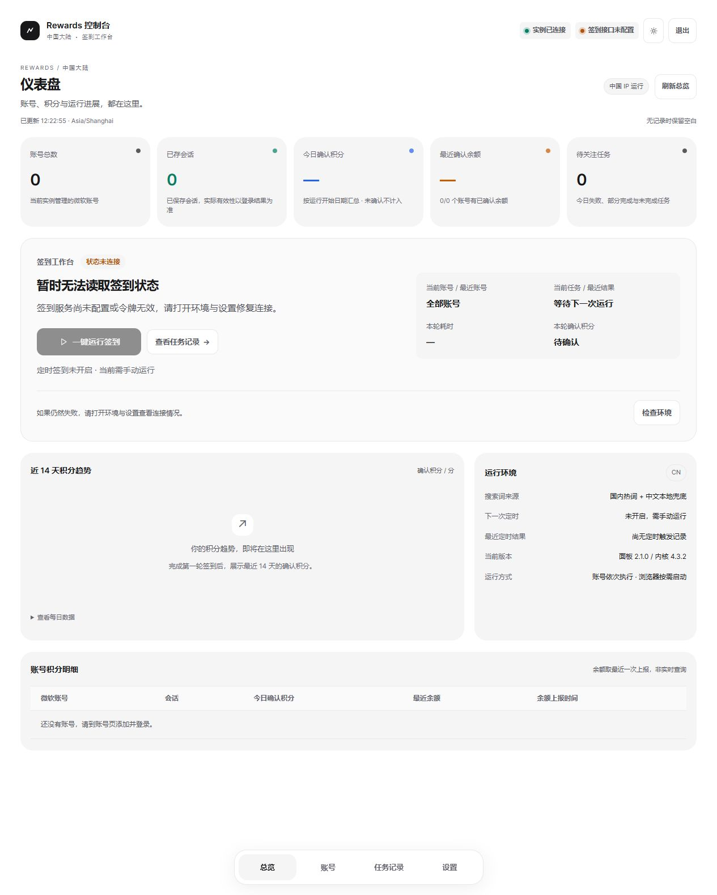

# 国区控制台 2.1 升级记录

本次完成本地代码、自动化检查与浏览器预览。没有连接或修改生产服务器，没有替换生产镜像，也没有运行真实微软账号任务。

## 国区运行

保留 TheNetsky 固定提交 `d0f07d74a0ed4dda127855d6e3dde98bf4c89d6e`，在编译产物上接入国区词源和等待进展，保留原有日志格式、会话结构和任务实现。构建时核对插入位置；上游结构变化或重复应用补丁会中止构建。

- 新版 Docker 首次迁移默认采用 `china`：国内热词 + 60 条中文本地词库。已有显式词源模式继续保留。
- 热词来自固定 gmya.net 的 BaiduHot / TouTiaoHot 接口。每源超时 8 秒、响应上限 256 KiB，去重并限制词条数量；限流后直接离线兜底，失败最多尝试两个来源。
- 成功热词在当前工作进程缓存 30 分钟，接口失败时本地结果缓存 5 分钟。无需新增服务。
- `china-local` 完全不请求热词接口；Bing 搜索与签到本身仍需联网。
- 设置提供国区建议值：搜索间隔 120–240 秒，阅读 60–120 秒，保留风控警告并关闭额外搜索与图片搜索。点击填入后仍需保存；不会静默覆盖用户已有间隔。
- 账号地区默认按 IP 自动识别，新增账号界面语言为 zh-CN。不会修改 IP、代理或现有账号的登录信息。
- 对脚本实际调用的至少 30 秒等待，上报开始时间和时长，面板据此倒计时；没有上报的操作显示最后进展时间，避免编造进度百分比。

## 页面与结果

参考 linux-do/cdk 的中性色、浅灰圆角卡片、克制边框与数据配色，提供总览 / 账号 / 任务记录 / 设置四个底部导航入口。移除远程 Google 字体依赖。小屏优先展示签到操作，大屏优先展示数据卡片。

总览包括账号数、已保存会话数、今日确认积分、最近确认余额、待关注任务、14 天趋势与每账号明细。无记录显示空态，未确认显示“待确认”，真实 0 分保留为 0；不会用历史非零收益冒充今日收益。以完整邮箱匹配账号。

积分按运行开始时的实例时区日期归属；跨日运行仍归入开始日。余额取每账号最近一次上报，带上报时间，不代表实时余额。会话已保存也不代表永不过期。

定时区域显示下一次触发时间，以及最近一次定时启动、失败或忙碌跳过的结果。仍沿用每天一次、到点忙碌跳过、不补跑的策略。当前版本分别展示面板与上游内核；没有实现自动更新或自动替换内核。

## 结果通知

Docker 工作进程在结束后发送 PushPlus 或 Server酱 Turbo 摘要；支持仅异常时发送。用户填写自己的 Token / SendKey 并开启后生效，默认关闭。

配置位于数据目录 `notifications.json`，Docker 权限 0600。API 只返回是否保存密钥，不回显密钥。留空保留，切换渠道需新密钥；关闭后可清除。摘要包含日期、状态、处理账号数量和确认积分，不发送邮箱、原始日志、会话或验证码。发送超时 8 秒，失败不改变签到结果，最近发送结果可在设置查看。

## 验证

- 自动化共 55 项通过：原有验收 27、Docker 接口与互斥 5、活动记录 10、运行与设置 7、新增国区功能 6。
- 实际拉取固定上游源码，安装锁定依赖并成功编译；对真实编译产物应用适配，加载 QueryCore / Utils 成功，实际返回 60 条中文离线词条。
- 本机真实请求热词接口，取得 51 条热词，合并后共 111 条；这不是服务器网络连通性的证明。
- 浏览器检查桌面及 390×844 手机尺寸。手机页面宽度未溢出，运行按钮底部约 520px，底部导航保持在视口内；设置页也未横向溢出。浏览器没有捕获到 JS 错误。
- UI 实际点击国区预设并保存成功。独立预览无微软账号、无生产记录、未连接真实 Control API，因此预览里的运行按钮禁用是预期现象。
- JavaScript 语法、HTML ID 唯一性与 `git diff --check` 通过。

本次没有构建 Linux Docker 镜像，也没有验证服务器上的登录、任务实际获分或真实通知送达。新增等待记录已纳入镜像构建阶段的活动记录 smoke guard，需实际构建时执行。

固定上游依赖安装时，npm audit 报告 3 个 high 项：adm-zip、brace-expansion、zod。它们来自原有上游锁文件，本次没有自动执行可能改变内核依赖的 audit fix；后续升级内核时需单独评估并回归。面板自身仍没有 npm 运行依赖。

## 借鉴来源

- [chiihero 国区分支](https://github.com/chiihero/Microsoft-Rewards-Script/tree/e0c15a6ae6bd102cb04f2a3351e2fa281f82961c)：参考国内热词、离线兜底与国内通知渠道的功能设计；没有整体替换成该分支。
- [asbdfzcg GUI](https://github.com/asbdfzcg/Microsoft-Rewards-Script/tree/76f9e9433020a76b8f2b1d2384a530b597e185c3)：参考积分总览、计划任务结果与集中设置的流程；没有引入 WinForms 或 Windows 计划任务。
- [linux-do/cdk](https://github.com/linux-do/cdk)：参考灰色卡片、中性色与信息层级；保留现有原生 HTML/CSS/JavaScript。
- Docker 镜像保留上游 LICENSE。上游代码、声明及其许可见 [TheNetsky 仓库](https://github.com/TheNetsky/Microsoft-Rewards-Script)。

[手机空数据预览](china-mobile-preview.jpg)
