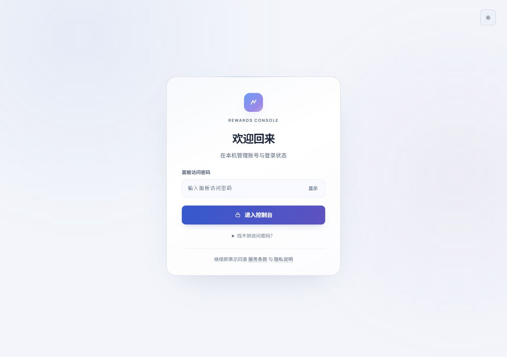
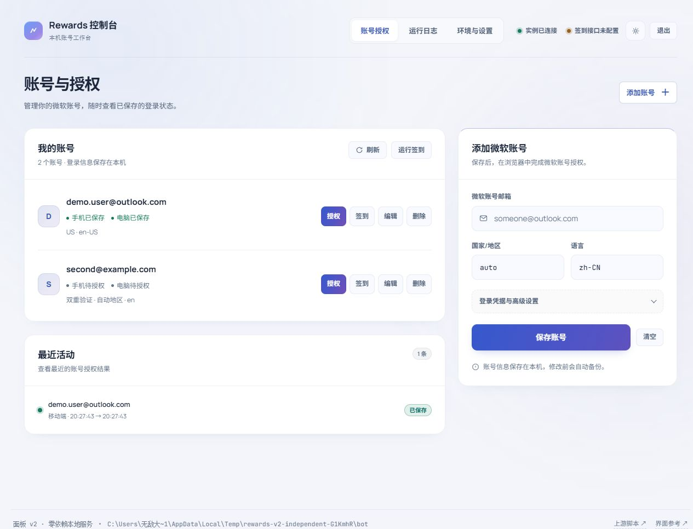
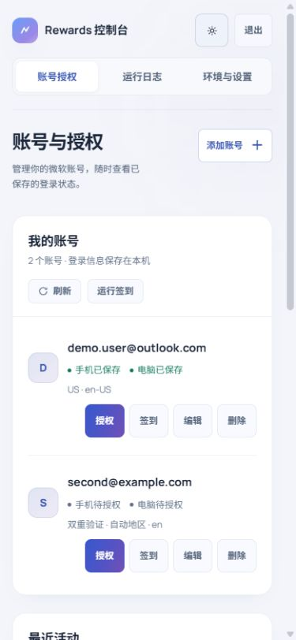

# 浅色渐变视觉调整

按本次确认，采用浅色作为默认主题，并保留深色切换。

## 设计选择

- 冷白背景配白色卡片，蓝与淡紫只作为柔和的环境色。
- 主要按钮使用较深的蓝紫渐变，停止持续流动；悬停时仅做小幅位移和渐变位置变化。
- 品牌保留轻盈渐变，账号头像改用低饱和底色。
- 账号状态改为文字与状态点，减少多色胶囊标签；技术细节放入提示和设置。
- 入口增加明确的卡片层次，密码获取说明折叠展示，入口也可切换主题。
- 提高主要字号、改善表单间距；修复两栏输入框重叠、提示句断行和新增账号序号显示。
- 密码、TOTP 与代理归入“登录凭据与高级设置”，手动授权的默认表单更简洁。
- 手机首屏提供“添加账号”入口，点击后跳转并聚焦邮箱；操作按钮高度为 44px。

## 修改文件

- `public/css/styles.css`：颜色、渐变、字号、卡片、布局、响应式、焦点样式与减少动态效果偏好。
- `public/index.html`：入口文案、主题切换、账号页标题、表单层级。
- `public/js/app.js`：默认浅色、状态展示、表单入口与显示序号。

修改前的三个文件保存在 `docs/design-backup-20261022/`。

## 验证

- 320、390、768、1280px 四个宽度，无横向溢出、无两栏输入框重叠。
- 手机输入字号 16px，账号操作按钮 44px，添加账号入口在首屏。
- 桌面两栏输入框间距从重叠 8px 改为正常间隔 12px。
- 使用虚构数据验证空表单提示、保存账号、编辑回填、高级设置、授权弹窗与任务结果展示。
- 实际本机页面切为浅色，重新加载后仍为浅色。
- 浏览器控制台无错误；JavaScript 语法检查通过。
- 主按钮三个声明色点的文字对比度约为 5.78～5.97:1；此为色值计算，不是完整无障碍认证。

尺寸检查记录：`design-responsive-check.json`。

本次为界面与展示流程调整。此前复审列出的服务端密码持久化、退出凭证撤销、自检及无效会话判定问题仍需处理；本次没有执行真实微软登录或签到。

## 预览

登录页为本机实际页面；工作台中的账号与会话均为虚构数据。

